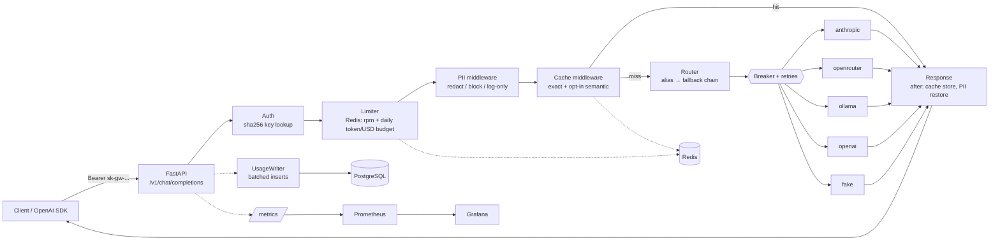

# Architecture

## Request flow

1. **Auth**: `Authorization: Bearer sk-gw-...` is hashed (SHA-256) and looked up in `api_keys` (30 s in-process cache).
2. **Limits**: Redis `INCR` on a per-key per-minute counter (429 + `Retry-After`); daily token and USD counters checked against the key's budgets (429, code `token_budget` / `usd_budget`).
3. **Pipeline `before()`** in order `pii → cache`. A cache hit (or a PII `block`) short-circuits and skips the provider.
4. **Router**: resolves the model alias to a chain of `(provider, upstream model)`. For each target: skip if its breaker is open; otherwise up to `max_retries + 1` attempts with full-jitter backoff; a retryable failure (timeout, 429, 5xx, transport error) counts against the breaker; when attempts run out, fall back to the next target. A non-retryable 4xx (bad request) goes straight back to the client and never trips a breaker.
5. **Pipeline `after()`** in reverse order: cache stores the (still redacted) response, then PII restores originals for the client.
6. **Accounting**: tokens/cost computed from the cost table, Redis budget counters incremented, a `usage_log` row queued for batched insert, Prometheus metrics updated.

**Streaming** (`stream=true`): `before()` runs, then the router streams. Retries/fallback apply until the first chunk is received, after which the provider is committed. Deltas pass through the PII `StreamRestorer` (handles placeholders split across chunks) on the way out; the aggregated response (with placeholders) goes to `after()` so the cache can store it. Cache hits are replayed as chunks.

## Components

| Module | Role |
|---|---|
| `gateway/app.py` | HTTP layer, request flow, SSE, error mapping to OpenAI-style errors |
| `gateway/router.py` | alias resolution, retries, breaker, fallback, streaming failover |
| `gateway/reliability.py` | `CircuitBreaker` (closed/open/half-open), jittered backoff |
| `gateway/providers/` | adapters: `openai_compat` (OpenAI, OpenRouter, Ollama), `anthropic`, `fake` |
| `gateway/auth.py`, `limits.py` | key hashing/lookup; Redis rate limit and budgets |
| `gateway/db.py`, `usage.py`, `migrations/` | SQLAlchemy models, batched usage writer, Alembic |
| `gateway/costs.py` | USD per 1M tokens per model |
| `gateway/pipeline.py`, `middleware/` | middleware contract and runner (pii, cache owned by Agent B) |
| `gateway/metrics.py`, `logging.py` | Prometheus metrics (multiprocess-aware), JSON logs with `request_id` |

## Metrics

`gateway_requests_total{status,model}`, `gateway_request_latency_seconds`, `gateway_provider_latency_seconds{provider,outcome}` (p50/p95 via `histogram_quantile`), `gateway_tokens_total`, `gateway_cost_usd_total`, `gateway_fallbacks_total{from_provider,to_provider}`, `gateway_retries_total`, `gateway_circuit_breaker_open{provider}`, `gateway_cache_requests_total{result}` (hit rate), `gateway_cache_lookup_seconds`, `gateway_rate_limited_total{reason}`. With several workers the app runs Prometheus in multiprocess mode (`PROMETHEUS_MULTIPROC_DIR`).
