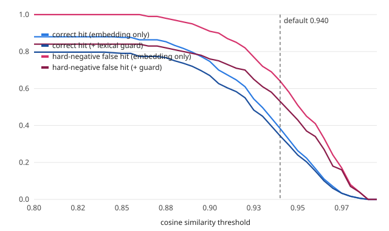

# Semantic cache: threshold selection and latency

Reproduce: `uv run python benchmarks/cache_eval.py` (writes `docs/cache_eval.json`, `docs/cache_eval_results.md`,
`docs/cache_threshold_curve.svg`).

## Data
`benchmarks/cache/paraphrases.jsonl`: 100 intent groups x 4 paraphrases (30 RU, 25 KK, 25 EN, 20 cross-lingual ru/kk/en).
`benchmarks/cache/hard_negatives.jsonl`: 100 minimal pairs with a *different* intent or answer (other number, entity,
negation, city, currency; 40 RU, 30 KK, 30 EN). Both sets were drafted by a small LLM and not reviewed by native speakers
(the Kazakh in particular), so treat per-language numbers as indicative. The hard negatives are adversarial by construction:
real traffic will have fewer near-identical-but-different queries, so the true false-hit rate is lower than shown, but it
is not measured here.

## Protocol
Index = the first text of each group (100 cached prompts). The 300 other texts are queries. Correct hit: top-1 is the own group
and sim >= t. Other-group false hit: top-1 is a different group and sim >= t. Hard-negative false hit: sim(a, b) >= t for a pair.
"+guard" additionally requires equal numbers and negation flag (`gateway/middleware/cache/guard.py`).

## Results
| threshold | hit (emb only) | hard-neg false hit (emb only) | hit (+guard) | other-group false hit (+guard) | hard-neg false hit (+guard) |
|---|---|---|---|---|---|
| 0.800 | 0.880 | 1.000 | 0.797 | 0.200 | 0.840 |
| 0.810 | 0.880 | 1.000 | 0.797 | 0.197 | 0.840 |
| 0.820 | 0.880 | 1.000 | 0.797 | 0.193 | 0.840 |
| 0.830 | 0.880 | 1.000 | 0.797 | 0.180 | 0.840 |
| 0.840 | 0.880 | 1.000 | 0.797 | 0.167 | 0.840 |
| 0.850 | 0.877 | 1.000 | 0.790 | 0.167 | 0.840 |
| 0.860 | 0.863 | 1.000 | 0.773 | 0.167 | 0.840 |
| 0.870 | 0.863 | 0.990 | 0.773 | 0.153 | 0.830 |
| 0.880 | 0.833 | 0.970 | 0.750 | 0.113 | 0.810 |
| 0.890 | 0.797 | 0.950 | 0.720 | 0.083 | 0.790 |
| 0.900 | 0.747 | 0.910 | 0.670 | 0.060 | 0.760 |
| 0.910 | 0.673 | 0.870 | 0.603 | 0.050 | 0.730 |
| 0.920 | 0.610 | 0.820 | 0.550 | 0.030 | 0.700 |
| 0.930 | 0.497 | 0.720 | 0.450 | 0.020 | 0.610 |
| 0.940 **←default** | 0.383 | 0.640 | 0.343 | 0.003 | 0.530 |
| 0.950 | 0.263 | 0.510 | 0.240 | 0.003 | 0.430 |
| 0.960 | 0.167 | 0.410 | 0.153 | 0.000 | 0.340 |
| 0.970 | 0.070 | 0.240 | 0.060 | 0.000 | 0.180 |
| 0.980 | 0.017 | 0.080 | 0.017 | 0.000 | 0.070 |
| 0.990 | 0.000 | 0.000 | 0.000 | 0.000 | 0.000 |

## Conclusions
- Mean similarity of true paraphrases is **0.925**, of hard negatives **0.946**: for this model the two overlap, so no
  threshold separates "same question" from "almost the same question with a different fact".
- Default **0.94** = lowest threshold with <= 0.5% other-group false hits. There: 34% paraphrase hit rate (RU 24%, KK 51%,
  EN 55%, cross-lingual 3% - the model barely matches across languages at this threshold), but 53% false hits on hard negatives
  (64% without the lexical guard, which removes mostly number/negation changes).
- Therefore the semantic cache ships **opt-in** and should be enabled per model alias for low-stakes, FAQ-like traffic, with
  a higher threshold if wrong answers are costly (0.97: 6% hit, 18% hard-negative false hit). The exact cache is always safe.
- Possible next steps (not done): a cross-encoder or small LLM verifier on semantic candidates; entity-aware guards.

## Embedding latency (CPU)
Model `intfloat/multilingual-e5-small`, fp32 ONNX, ONNX Runtime, 2 intra-op threads, 12-core x86_64 laptop/desktop,
max length 128 tokens, 100 single-text runs after warm-up: **p50 22 ms, p95 45 ms**; batch of 8: ~150 ms mean.
This latency is added to every semantic-enabled cache miss (the embedding is computed once and reused for the store).
